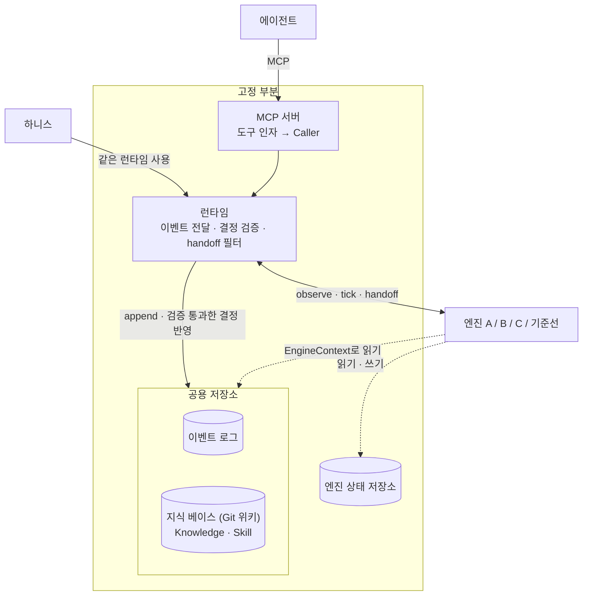

# 엔진 포트 계약 v0.1.0

> 상태: 초안 (PR #1 리뷰 2차 반영, D1~D7 합의). 코드 정본은 `src/cortex_mem/contract.py`(포트), `src/cortex_mem/access.py`(scope 규칙), `src/cortex_mem/runtime.py`(런타임).
> 이 문서의 규칙 중 타입으로 표현되지 않는 것(호출 순서, id·scope 의미, 런타임 동작)도 계약의 일부다.

## 1. 무엇이 고정이고 무엇이 교체되나



- 각자 만드는 건 `Engine` 하나. 엔진은 `EngineFactory = Callable[[Mapping[str, str]], Engine]`로 만들어진다. 생성자는 엔진 설정만 받고, 저장소는 매 호출의 `ctx`로 받는다.
- 엔진은 공용 저장소를 **읽기만** 하고, 승격·강등은 **결정(Decision)으로 반환**한다. 지식 베이스에 쓰는 건 런타임뿐이다.
- 엔진이 자기 데이터를 남길 곳은 `ctx.state`(엔진 전용 영속 저장소)다.
- 서버와 하니스는 같은 `Runtime`을 쓴다. 그래서 하니스 점수가 서버에서의 동작을 대표한다.

공용 저장소를 엔진에 넘기지 않는 이유: 같은 원본·같은 검색 위에서 승격 로직만 달라야 엔진 간 점수 차이가 승격 로직의 차이가 되고, 1등 엔진에 다른 엔진의 아이디어를 옮겨 붙일 수 있다.

**결정 (통제 변인)**: 검색(`EventReader.search`, `KnowledgeReader.search`)은 공용으로 고정한다. 엔진은 검색 결과를 재정렬하거나 골라낼 수 있지만, 자기 검색 색인을 따로 두지 않는다. 공용 검색을 쓰지 않는 외부 시스템(§8 어댑터)의 결과는 하니스 리포트에서 따로 해석한다.

## 2. 타입

### Event — 관찰 하나

| 필드 | 타입 | 설명 |
|---|---|---|
| `id` | str | 호출자가 정한다(서버: uuid, 하니스: 시드에서 결정적으로). 중복이면 `append`가 `ValueError` |
| `kind` | `record` · `recall` · `outcome` · `human_confirm` · `commit` | |
| `at` | datetime | **timezone 필수**. 없으면 생성 시 `ValueError` |
| `user`, `team`, `session` | str | 매 호출마다 받는다. 독립 출처를 세는 기본 단위 |
| `scope` | `personal` · `team` · `org` | 이 기록을 누구에게 보일지 (§3-3) |
| `text` | str | record: 기록 내용, recall: 질의, commit: 커밋 메시지 |
| `agent` | str? | 클라이언트 종류 (claude-code, cursor, codex …) |
| `signal` | `self` · `test` · `review` · `human` · `doc`? | 증거 신호 종류 |
| `outcome` | `success` · `failure` · `unknown`? | outcome 이벤트의 결과 |
| `conditions` | Mapping[str, str] | **이 주장이 참인 조건만**. 예: `{"repo": "api", "service": "A"}`. 생성 시 읽기 전용으로 고정된다 |
| `refs` | tuple[str, ...] | 다른 항목을 가리키는 id (§3-2) |
| `repo`, `rev` | str? | 근거가 나온 곳(저장소, 커밋·CI 실행 id). `conditions`와 섞지 않는다 |
| `text_redacted` | bool | 호출자가 받은 `text`를 저장하지 않았다는 표시(기본 `False`). 서버는 저장소 정책보다 넓게 공개되는 outcome에서 판정만 남기고 본문을 비운다(§3-8). 엔진은 "원래 본문이 없는 판정"과 구분할 수 있다 |

`conditions`에는 조건부 사실을 판정하는 데 필요한 맥락(`repo`, `service`, `db` …)을 넣는다. 키 이름은 소문자 snake_case로 쓴다.

### Caller — 지금 부르는 쪽

`user`, `team`, `session`, `at`(timezone 필수), `agent`, `repo`, `context`. 서버는 연결과 설정에서, 하니스는 시나리오(가상 시각)에서 채운다. 질의 범위 `scope`는 Caller와 별도 인자로 받는다.

- `repo`: 지금 작업 중인 저장소. 서버는 프로젝트별 설정 `CORTEX_REPO`를 기본값으로 쓰고, 도구 인자로 덮어쓸 수 있다. 하니스는 문항의 repo. 도구 인자는 위치만 바꾸고 scope 정책은 바꾸지 못한다(§3-8).
- `context`: 질문한 맥락(`{"service": "api"}` 등). 키 규칙은 `conditions`와 같다. 생성 시 읽기 전용으로 고정된다.
- 조건부 사실(`Event.conditions`)이 이 질문에 해당하는지 판단하는 건 **엔진 몫**이다. 런타임은 `repo`·`context`로 거르지 않는다.
- recall 이벤트는 `repo`·`conditions`에 질문한 곳(`Caller.repo`, `Caller.context`)을 남긴다.

### Knowledge — 승격된 항목 하나 (위키 문서 하나)

| 필드 | 타입 | 설명 |
|---|---|---|
| `id` | str | 엔진이 정한다. **안정적**이어야 한다(위키 경로가 된다) |
| `kind` | `knowledge` · `skill` | |
| `title`, `body` | str | body는 마크다운 |
| `scope` | `personal` · `team` · `org` | 누구에게 보일지 |
| `owner` | str | personal: user id, team: team id, org: `"*"` (v0.1은 조직 하나) |
| `sources` | tuple[str, ...] | 근거 이벤트 id. **비면 거부**된다 |
| `conditions` | Mapping[str, str] | 이 항목이 유효한 조건 |

### Decision — 엔진이 반환하는 결정

- `Promote(item)`: 항목을 만들거나, 같은 id의 항목을 바꾼다.
- `Demote(id, reason, sources, why="invalid", since=None)`: 항목을 지식 베이스에서 뺀다. `sources`는 강등 근거(실패 outcome 등).
  - `why`: `invalid`(틀렸거나 틀리게 됨) · `stale`(더 이상 쓸모없음, 보관). 런타임 처리는 같고 하니스가 따로 센다.
  - `since`: 언제부터 참이 아닌지(알면, timezone 필수). 위키는 Git이라 내린 항목도 이력에 남으므로, 유효 기간은 "Promote 커밋 ~ `since`"로 보인다.

결정 종류는 "런타임이 다르게 처리해야 하는가"를 기준으로 두 가지만 둔다.

| 하려는 일 | 결정 |
|---|---|
| 승격 | `Promote(item)` |
| 갱신 | 같은 id로 `Promote(item)` |
| Skill화 | `Promote(item)`, `item.kind = "skill"` |
| 무효화 | `Demote(id, ..., why="invalid", since=...)` |
| 보관(오래된 기억 정리) | `Demote(id, ..., why="stale")` |

위키에 남긴 채 검색에서만 빼는 것처럼 처리가 달라져야 하는 종류가 필요해지면 그때 추가한다.

### Handoff — 엔진이 에이전트 컨텍스트에 넣는 항목 하나

| 필드 | 타입 | 설명 |
|---|---|---|
| `id` | str | **호출 사이에 안정적**이어야 한다(recall 이벤트의 `refs`로 돌아온다). 지식 항목이면 그 id |
| `content` | str | 에이전트에게 보일 내용 |
| `sources` | tuple[str, ...] | 근거 이벤트 id. 호출자가 볼 수 없는 것이 하나라도 있으면 런타임이 뺀다 (§3-5) |
| `status` | `memory` · `knowledge` · `invalidated`? | **선택**. 에이전트 표시용이며 채점에는 쓰지 않는다 |
| `conditions` | Mapping[str, str] | 이 항목이 유효한 조건 |
| `confidence` | float? | 0..1. 주면 Brier 점수로 확률 채점 |

### 엔진이 받는 것과 구현하는 것

```python
class EventReader(Protocol):            # 이벤트 로그, 읽기 전용
    def get(self, ids) -> list[Event]: ...
    def search(self, query, caller, scope, k=20, kinds=None) -> list[tuple[Event, float]]: ...

class KnowledgeReader(Protocol):        # 지식 베이스의 현재 상태, 읽기 전용
    def get(self, ids) -> list[Knowledge]: ...
    def all(self) -> list[Knowledge]: ...
    def search(self, query, caller, scope, k=20) -> list[tuple[Knowledge, float]]: ...

class StateStore(Protocol):             # 엔진 전용 영속 저장소, JSON 값
    def get(self, key): ...
    def put(self, key, value): ...
    def delete(self, key): ...
    def scan(self, prefix=""): ...

@dataclass(frozen=True)
class EngineContext:
    events: EventReader
    knowledge: KnowledgeReader
    state: StateStore

class Engine(Protocol):
    state_version: str                  # 선택. 바뀌면 상태를 버리고 처음부터 다시 전달 (§3-8)
    def observe(self, event, ctx) -> Sequence[Decision]: ...
    def tick(self, now, ctx) -> Sequence[Decision]: ...
    def handoff(self, query, caller, scope, ctx, k=6) -> list[Handoff]: ...
```

`Engine`은 `runtime_checkable`이라 하니스가 `isinstance`로 구현 여부를 확인한다. 위키를 검색해 건네는 기본 handoff는 `cortex_mem.kit.handoff_from_knowledge`로 제공한다(선택).

## 3. 규칙

### 3-1. 런타임과 호출 순서

1. 모든 이벤트는 `append` 순서대로 **정확히 한 번** `observe`에 전달된다. 커서는 런타임이 관리하고, 엔진은 재생이나 커서를 신경 쓰지 않는다.
2. 이벤트 하나의 전달은 트랜잭션 하나다. `observe`가 반환하면 그 호출의 상태 쓰기, 결정 반영, 커서 이동이 함께 반영된다. `observe`가 예외를 던지면 아무것도 반영되지 않고, 그 이벤트는 다음 `sync` 때 다시 전달된다. 다른 프로세스가 먼저 전달했으면(`CursorConflict`) 이쪽 결과는 버리고 커서를 다시 읽는다.
   - **계속 실패하는 이벤트**: `Runtime(..., max_failures=N)`이면 같은 이벤트에서 `observe`가 N번 실패했을 때 그 이벤트를 건너뛴다. 커서만 넘기고 그 호출의 쓰기는 남기지 않으며, `Runtime.skipped`(`seq`, `event_id`, `attempts`, `error`)에 남긴다. 이벤트 자체는 로그에 남는다. 기본값 `None`은 건너뛰지 않고 매번 예외를 던진다.
   - 하니스는 `None`으로 쓴다. 엔진 실패를 조용히 넘기면 "엔진이 실패했는데 점수는 나온" 상태가 되기 때문이다. 서버는 한 이벤트가 모든 세션을 막지 않도록 `CORTEX_MAX_FAILURES`(기본 3)로 켠다.
   - 실패 횟수와 `skipped`는 `verdicts`처럼 프로세스 메모리에만 있다(영속화는 §6).
3. 이벤트는 `append` 뒤에 전달되므로, 엔진은 `observe` 안에서 그 이벤트를 `ctx.events.get`할 수 있다.
4. `handoff` 직전에 런타임이 밀린 이벤트를 먼저 전달한다. 그래서 세션 B도 세션 A가 남긴 기록을 반영한 상태로 답한다.
5. recall 한 번은 이렇게 흐른다(`Runtime.recall`).
   ```
   handoffs = runtime.handoff(query, caller, scope, k)        # 필터 통과분
   runtime.append(Event(kind="recall", text=query, refs=tuple(h.id for h in handoffs), ...))
   return handoffs  # 에이전트에게
   ```
   엔진은 자기가 건넨 것이 무엇인지 recall 이벤트로 다시 관찰한다. recall 이벤트는 검색한 범위와 상관없이 `personal`로 남는다. 질의는 그 사람이 무엇을 하는지 드러내기 때문이다.

### 3-2. `refs` 의미

| kind | refs |
|---|---|
| `recall` | 에이전트에게 건넨 Handoff id |
| `outcome`, `human_confirm` | 판정 대상인 이벤트 또는 Handoff id. **비면 `Runtime.append`가 `ValueError`로 거부한다.** 가리키는 id가 있는지는 검사하지 않는다(Handoff id는 지식 항목이 아닐 수 있고, 이미 강등됐을 수 있다) |
| `record` | 이 기록을 쓰기 직전에 건네받은 Handoff id (알면). 에이전트가 받은 걸 다시 말한 건지 구분하는 단서 |
| `commit` | 비워 둔다 |

### 3-3. scope 가시성 (`access.py`)

범위는 personal < team < org 순으로 넓어진다.

| 질의 scope | 보이는 이벤트 | 보이는 지식 |
|---|---|---|
| `personal` | 내 이벤트 | 내 personal 항목 |
| `team` | + 우리 팀의 `team` 이벤트 | + 우리 팀의 team 항목 |
| `org` | + 모든 `org` 이벤트 | + org 항목 |

다른 사람의 `personal` 이벤트와 다른 팀의 `team` 이벤트는 어떤 scope로도 보이지 않는다.

### 3-4. 결정 검증

런타임은 결정을 지식 베이스에 반영하기 전에 검사한다. 통과한 결정은 **사람 승인 없이 즉시** 반영된다. 모든 결정은 `Runtime.verdicts`에 `(결정, 승인 여부, 거부 사유, 시각)`으로 남고(`rejections`는 거부된 것만), 하니스는 이를 **관찰 지표**로 리포트에 싣는다. 판정 지표에는 넣지 않는다(하니스는 에이전트에게 닿은 결과로만 채점).

- `Promote`: id가 비어 있지 않고, `sources`가 비어 있지 않고, 모두 존재하고, **모두 그 항목을 볼 사람 전원에게 보여야** 한다.
- `Demote`: 대상 항목이 있어야 하고, `sources`가 위와 같은 조건을 그 항목의 범위에 대해 만족해야 한다.
- 한 번에 반환한 결정들은 순서대로 검사된다. 앞에서 승격한 항목을 뒤에서 강등할 수 있다.

| 항목 scope | 근거로 쓸 수 있는 이벤트 |
|---|---|
| personal (owner = user) | 그 사용자의 이벤트, org 이벤트 |
| team (owner = team) | 그 팀의 `team` 이벤트, org 이벤트 |
| org | org 이벤트 |

그래서 **personal 기록은 팀 지식의 근거가 될 수 없다.** 서로 다른 사람 여러 명의 personal 기록이어도 같다. 사람 사이의 교차 확인으로 승격하는 경로는 기록이 처음부터 team으로 남아야 열린다. 이 기본값은 에이전트가 아니라 서버 설정이 정한다(§3-8).

personal 기록 여러 개로 팀 지식을 만드는 것(롤업)을 v0.1에서 허용하지 않는 이유:
- 허용해도 handoff 필터(§3-5)가 팀원에게는 그 항목을 빼게 된다. 팀원은 근거를 볼 수 없기 때문이다. 필터까지 풀면 "근거는 모두 호출자가 볼 수 있어야 한다"(하니스 M3)가 깨진다.
- 개인 식별 정보 검사는 문자열 검사라, 엔진이 요약하거나 바꿔 쓰면 개인 내용이 통과한다. 구조로 보장할 수 없다.
- v0.2 후보: 런타임이 "서로 다른 N명이 같은 주장을 함"이라는 집계 이벤트를 만들고(원본 id 비공개), 그것을 근거로 쓰는 방식.

### 3-5. handoff 필터

런타임은 엔진이 건넨 항목 중 다음을 뺀다: `sources`가 비었거나, 없는 이벤트를 가리키거나, 호출자가 그 scope로 볼 수 없는 이벤트가 하나라도 있는 항목. 항목 id가 지식 항목이면 그 항목도 호출자에게 보여야 한다. 그 뒤 `k`개로 자른다.

누출을 막는 지점은 결정 검증(§3-4)과 이 필터 두 곳뿐이고, 둘 다 고정 부분에 있다. 엔진은 모든 이벤트를 관찰하지만, 나가는 것은 항상 검사된다.

### 3-6. 시간

엔진은 시계를 직접 읽지 않는다. `event.at`, `tick(now)`의 `now`, `caller.at`만 쓴다. 서버는 이벤트를 전달할 때 현재 시각으로, 하니스는 시나리오가 정한 시각에 `tick`을 부른다. 오래된 기억 정리와 만료는 `tick`에서 결정으로 반환한다.

### 3-7. 결정성

같은 이벤트·tick 순서를 넣으면 같은 결정과 같은 `handoff`가 나와야 한다. 하니스가 재실행 뒤집힘률(목표 10% 이하)을 잰다. 엔진 안에서 난수를 쓰면 시드를 고정한다.

### 3-8. 엔진 상태와 scope 기본값

- 오래 남길 상태는 `ctx.state`에만 둔다. 인스턴스 필드는 캐시로만 쓴다. 서버 프로세스가 여러 개 떠서 같은 저장소를 쓸 수 있기 때문이다.
- `ctx.state`의 값은 JSON이고, 넣고 꺼낼 때 복사된다. 커밋 전의 값도 마찬가지다(런타임이 JSON 문자열로 들고 있다가 꺼낼 때마다 새로 만든다). `handoff`에서는 읽기 전용이다.
- 값 하나는 JSON으로 64 KiB까지다(`MAX_STATE_VALUE_BYTES`). 넘으면 `put`이 `ValueError`를 던진다.
- **권장: 대상 하나당 키 하나.** 상태 전체를 값 하나에 넣으면 이벤트마다 전체를 다시 쓰게 된다. 예시:
  ```
  memory:<memory_id>                  L1 기억 하나
  claim:<claim_id>                    L2 주장 하나 (정규화 키, 상태, 조건, 점수)
  claim_key:<canonical_key>           정규화 키 → claim_id (중복 확인용 색인)
  evidence:<claim_id>:<event_id>      증거 한 줄 (지지/반박, 독립성 키, 종류)
  retrieval:<session>:<handoff_id>    이 세션에 건넨 항목 (자기강화 차단용)
  ```
  증거 키에 `event_id`를 넣으면 같은 이벤트를 다시 받아도 두 번 세지 않는다(재전달에 대한 안전장치).
- **상태 형식 버전**: 엔진에 `state_version: str`을 두면, 저장된 버전과 다를 때 런타임이 상태를 지우고 커서를 0으로 돌려 이벤트 로그 처음부터 다시 전달한다. 마이그레이션 코드는 필요 없다. 지식 베이스는 지우지 않는다(다시 나온 Promote가 같은 id를 덮어쓴다). 버전이 다른 서버 프로세스를 동시에 띄우지 않는다.
- record의 scope 기본값은 서버 설정(저장소 → 기본 scope)이 정하고, 에이전트는 기본값보다 **좁히는 것만** 할 수 있다. 저장소 정책은 설정된 저장소(`CORTEX_REPO`)로만 고른다. 도구 인자 `repo`는 근거 위치(`Event.repo`)만 바꾸므로, 기본값이 더 넓은 저장소 이름을 넘겨 범위를 넓힐 수 없다. 설정된 저장소가 없으면 기본 정책(`CORTEX_RECORD_SCOPE`)만 적용한다. recall의 기본 scope는 볼 수 있는 가장 넓은 범위다.
- outcome(결과 보고)의 scope 기본값은 **판정 대상 지식의 범위**다. 그래야 팀 지식을 강등하는 근거가 된다. 에이전트는 좁히는 것만 할 수 있다. 하니스처럼 scope를 직접 정하는 호출자는 팀 지식에 대한 결과 이벤트를 team으로 넣어야 강등이 일어난다.
- 그 범위가 설정된 저장소의 정책보다 넓으면(예: personal 정책 저장소에서 org 지식을 판정) 서버는 판정(`outcome`·`signal`·`refs`)만 남기고 `text`를 비운 뒤 `text_redacted=True`로 표시한다. 강등에 필요한 건 판정이고, 에이전트가 쓴 본문(경로, 내부 사정)은 저장소 정책을 따른다. refs에 범위가 다른 항목이 섞이면 가장 넓은 범위 하나로 남는다.

## 4. 하니스

### 하니스 이벤트 ↔ Event 대응

| 하니스 이벤트 | kind | 주요 필드 |
|---|---|---|
| 에이전트 기록 | `record` | `text`, `agent`, `signal="self"`, `conditions` |
| recall 요청과 응답 내용 | `recall` | `text`=질의, `refs`=건넨 Handoff id |
| CI·테스트 결과 (앞선 기록·항목을 판정) | `outcome` | `signal="test"`, `outcome`, `refs`(필수), `repo`, `rev` |
| CI·테스트 결과 (단독 증거) | `record` | `signal="test"`, `outcome`, `repo`, `rev` |
| 사람 확인 | `human_confirm` | `signal="human"`, `outcome`, `refs` |
| 문서 근거 | `record` | `signal="doc"`, `repo`, `rev` |
| 대상 코드 커밋(여러 저장소) | `commit` | `repo`, `rev`, `text`=커밋 메시지 |

### 채점

- 엔진마다 시나리오별로 새 `InMemoryDatabase`와 `Runtime`을 만들어 같은 이벤트를 흘려 넣는다. 하니스는 엔진을 직접 부르지 않고 런타임만 부른다(서버와 같은 진입점).
- 주 채점은 에이전트에게 건넨 결과(handoff)로 한다. 지식 베이스 상태(`knowledge.all()`)는 신뢰도 채점(Brier, v0.2) 같은 선택 기능에만 쓴다.
- 판정 기준선은 같은 런타임 위의 `PromoteAllEngine`이다. **비교는 인메모리 저장소 기준**이다. 저장소 구현마다 검색 점수 함수가 달라(SQLite FTS5 `bm25`, PostgreSQL `ts_rank`) 같은 데이터에서도 순위가 달라질 수 있으므로, 하니스 비교는 저장소 구현 하나로 고정한다.
- 런타임은 `max_failures=None`(기본값)으로 만든다(§3-1).
- 관찰 지표: 결정 기록(`verdicts`: 승인·거부, 사유, 근거 id), `why`별 강등 수, handoff 필터에 걸린 수.

## 5. 고정 부분의 저장소 인터페이스 (`store/base.py`)

엔진은 보지 않는다. 저장 계층 구현(SQLite, PostgreSQL)이 지킬 것이다.

```python
class EventStore(EventReader, Protocol):
    def append(self, event) -> str: ...
    def since(self, seq) -> Iterator[tuple[int, Event]]: ...   # 위치는 1부터, 커밋 순서대로 늘어나기만

class KnowledgeStore(KnowledgeReader, Protocol):
    def put(self, item) -> None: ...
    def remove(self, id) -> None: ...

class EngineStateBackend(Protocol):                           # 엔진 하나의 상태 + 커서
    def get(self, key): ...
    def scan(self, prefix=""): ...
    def cursor(self) -> int: ...
    def commit(self, expected, cursor, writes, deletes) -> None: ...  # 커서가 expected가 아니면 CursorConflict
    def version(self) -> str | None: ...                      # 상태를 쓴 엔진의 state_version
    def reset(self, version) -> None: ...                     # 키 전부 삭제, 커서 0, 버전 기록

class Database(Protocol):                                     # 한 연결 뒤의 저장소 전부
    events: EventStore
    knowledge: KnowledgeStore
    def state(self, engine) -> EngineStateBackend: ...       # 엔진별 이름공간
    def transaction(self): ...
```

- `cortex_mem.testing`의 `EventStoreContract`, `KnowledgeStoreContract`, `EngineStateBackendContract`, `DatabaseContract`를 상속해 `make()`만 구현한 테스트가 통과하면 계약을 지킨 것이다(`tests/test_store.py` 참고). `DatabaseContract`는 런타임을 올려 정확히 한 번 전달, 실패 시 전부 롤백, 재접속 후 유지, 상태 버전 교체를 확인한다. `search` 점수는 "높을수록 좋음"만 약속한다.
- 영속 구현은 `Runtime(..., transaction=...)`에 쓰기 트랜잭션을 넘겨, 커서·엔진 상태·지식 반영을 **한 트랜잭션**으로 묶고 프로세스 사이에서 직렬화한다. 인메모리 구현은 단일 프로세스라 기본값(`nullcontext`)을 쓴다.
- 커서의 compare-and-set(`expected`)은 여러 프로세스가 같은 엔진 상태를 쓸 때 이중 전달을 막는다.
- **append의 위치는 커밋 순서대로 늘어나야 한다.** 커서는 "이 위치까지 전달했다"는 뜻이라, 작은 위치가 큰 위치보다 늦게 커밋되면 그 이벤트는 영영 전달되지 않는다. SQLite는 쓰기가 한 번에 하나라 자동으로 지켜진다. PostgreSQL의 `bigserial`은 번호를 먼저 받은 트랜잭션이 나중에 커밋될 수 있으므로, append를 `transaction()` 안에서 잠금(advisory lock 등)으로 직렬화한다. PG 구현에는 동시 append 두 개를 섞는 적합성 테스트를 추가한다(지금의 `DatabaseContract`로는 잡히지 않는다).
- **한국어 검색**: 토큰(`words`, 한글 2-gram `grams`)을 Python에서 미리 만들어 저장한다. PostgreSQL도 `to_tsvector('simple', words || ' ' || grams)`로 같은 토큰을 쓰면 확장 없이 옮겨진다.

## 6. v0.2 이후로 미룬 것

- **LLM 주입**: 엔진이 LLM을 쓰면 하니스가 모델 버전과 호출 예산을 정해 주입한다. `EngineContext`에 필드로 추가하므로 엔진 시그니처는 바뀌지 않는다.
  - 제공자는 Upstage, 예산은 팀 크레딧 합계 $330(1인 $110). 엔진·실행별 예산 배분은 하니스 설계에서 정한다.
  - **기존 연구 채점이 시작되기 전까지 필요하다.**
- **HTTP 전송과 인증**: 토큰 → (user, team). 서버 PR 이후.
- **팀 간(org) 승격**: 여러 팀의 지식을 org로 올리는 경로. v0.1은 org 이벤트만 org 지식의 근거가 된다.
- **결정 기록의 영속화와 엔진에 알리기**: v0.1은 `Runtime.verdicts`와 `Runtime.skipped`(메모리)에만 남는다. 위키 커밋 메시지에 같은 내용을 남기는 것은 위키 반영기와 함께.
- **personal 기록 롤업**: §3-4의 집계 이벤트 방식.
- **사람 승인·커밋 입력 경로**: 관리 CLI, Git·CI 훅으로 `human_confirm`·`commit` 이벤트를 넣는 관례.
- 계약을 바꿀 때는 `CONTRACT_VERSION`을 올리고 근거를 이 문서에 남긴다.

## 7. 팀 확인 필요

**합의됨 (10/20, PR #1·#2 리뷰)**
- [x] D1 저장소의 주인: 고정 부분이 소유, 엔진은 결정만 반환 (§1)
- [x] D2 승격 즉시 반영, 결정 기록은 관찰 지표 (§3-4)
- [x] D3 엔진 포트 모양: `observe` / `tick` / `handoff` + `EngineContext` (§2)
- [x] D4 엔진 상태 저장소: 키-값(JSON), 같은 트랜잭션으로 커밋, 상태 버전 (§3-8)
- [x] D5 scope 정책: 기본값은 서버 설정, 에이전트는 좁히기만, 팀 간 승격은 v0.1 제외 (§3-4, §3-8)
- [x] D6 handoff는 엔진 몫, 범위 필터는 런타임 (§3-5)
- [x] D7 서버 전송: 최종 HTTP 하나, v0.1은 공용 DB + stdio 가능 (PR #2)

**합의됨 (10/20, 2차 리뷰)**
- [x] 결정 종류는 Promote·Demote 두 가지 + `why`·`since` (§2)
- [x] personal 기록 롤업은 v0.1 제외 (§3-4)
- [x] outcome scope 기본값 = 판정 대상 지식의 범위 (§3-8)
- [x] 질문 맥락 `Caller.repo`·`context` (§2), outcome·human_confirm의 refs는 append에서 검사 (§3-2)

**합의됨 (10/21, PR #2 리뷰)**
- [x] scope 정책은 설정된 저장소로만 고른다. 도구 인자 `repo`는 위치만 (§3-8)
- [x] 계속 실패하는 이벤트: `Runtime(max_failures=N)`, `Runtime.skipped`. 하니스는 `None`, 서버는 `CORTEX_MAX_FAILURES`(기본 3) (§3-1)
- [x] 저장소 정책보다 넓은 outcome은 `text`를 비우고 `Event.text_redacted` (§2, §3-8)
- [x] append 위치는 커밋 순서, 판정 기준선 비교는 인메모리 저장소 기준, 한국어 검색은 `simple` (§4, §5)

**합의됨 (10/25)**
- [x] 레포 이름은 `cortex-mem/core` (계약·런타임·저장소와 MCP 서버를 함께 담음). 패키지 이름 `cortex-mem`·`cortex-mem-server`는 그대로

**저장 계층 (PostgreSQL + pgvector)**
- [ ] 임베딩 모델 = 벡터 차원. Upstage 임베딩으로 바꾸면 pgvector 인덱스 한도에 걸릴 수 있다(차원 수치는 확인 필요).
- [ ] 공용 DB 위치: team scope는 공용 DB가 있어야 사람 간 독립 출처를 셀 수 있다.

**모두**
- [ ] 독립 출처의 기본 단위를 `user`로 볼지, `(user, session)`으로 볼지. 계약은 둘 다 담을 수 있고, 판정은 엔진 몫이다.

## 8. 기존 연구를 엔진으로 감싸기 (예시)

`add`/`search` API를 가진 외부 메모리 시스템은 자기 저장소를 쓰는 **예외**로 허용한다. 대신 handoff의 `sources`에 원래 이벤트 id를 유지해야 한다. 근거를 잃은 항목은 런타임 필터(§3-5)가 뺀다.

```python
from collections.abc import Mapping

from cortex_mem.contract import Caller, EngineContext, Event, Handoff, Scope


class ExternalMemoryAdapter:
    def __init__(self, config: Mapping[str, str]):
        self.client = make_client(config)  # 외부 시스템 클라이언트

    def observe(self, event: Event, ctx: EngineContext):
        if event.kind == "record":
            self.client.add(event.text, user_id=event.user, metadata={"event_id": event.id})
        return []  # 위키 승격은 하지 않는다

    def tick(self, now, ctx):
        return []

    def handoff(self, query: str, caller: Caller, scope: Scope, ctx: EngineContext, k: int = 6):
        hits = self.client.search(query, user_id=caller.user, limit=k)
        return [
            Handoff(id=h["id"], content=h["text"], sources=(h["metadata"]["event_id"],))
            for h in hits
        ]
```

- `client.add`·`client.search`의 이름과 반환 모양은 시스템마다 다르다. 위 코드는 모양만 보여 준다.
- `user_id=caller.user`로는 personal scope만 흉내 낸다. team scope를 채점하려면 팀 단위 id를 따로 둬야 한다.
- 외부 시스템이 기억을 합치면 `metadata`가 사라져 항목이 필터에 걸릴 수 있다. 하니스는 이를 별도 수치로 보고한다.

## 9. 디스코드 공유용 요약

```
[T5] 엔진 포트 계약 v0.1 (리뷰 반영) — docs/contract.md
- 엔진이 구현할 것: observe(event, ctx) / tick(now, ctx) → 결정 목록, handoff(query, caller, scope, ctx, k)
- 승격·강등은 Promote/Demote로 반환 → 런타임이 근거·범위 검증 후 즉시 지식 베이스에 반영 (갱신=같은 id Promote, Skill=kind="skill", 보관=Demote why="stale")
- 엔진 데이터는 ctx.state(전용 영속 저장소, JSON, 값당 64 KiB)에. 대상 하나당 키 하나 권장. state_version 바꾸면 처음부터 재전달
- 이벤트는 런타임이 커서로 정확히 한 번 전달. 시작 시 전체 재생 없음
- 누출 검사는 런타임 두 곳: 결정 검증 + handoff 필터
- scope: personal < team < org. personal 기록은 팀 지식의 근거가 될 수 없음
- Event에 team 추가, conditions는 읽기 전용, Caller(user, team, session, at, agent, repo, context) 도입
- outcome·human_confirm은 refs(판정 대상 id) 없으면 append 거부
- scope 정책은 설정된 저장소(CORTEX_REPO)로만. 정책보다 넓게 공개되는 outcome은 text를 비우고 text_redacted
- 계속 실패하는 이벤트는 Runtime(max_failures=N)이 건너뛰고 skipped에 남김(하니스는 None = 건너뛰지 않음)
- 하니스는 같은 Runtime + InMemoryDatabase로 실행, handoff로 채점. 결정 기록(verdicts)은 관찰 지표
- 저장소 공통 테스트(cortex_mem.testing): PG 구현도 이걸 상속해 통과하면 계약 준수
```
