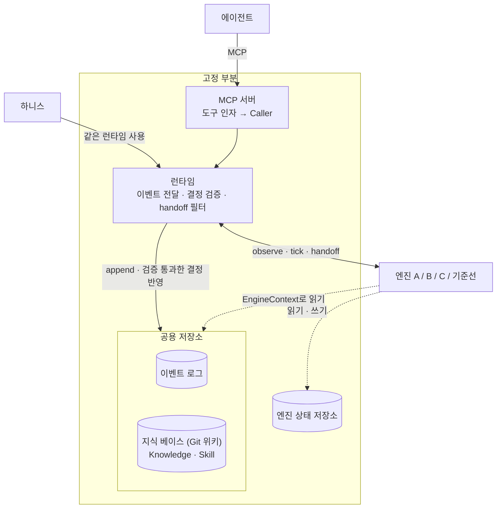

# 엔진 포트 계약 v0.1.0

> 상태: 초안 (PR #1 리뷰 반영). 코드 정본은 `src/cortex_mem/contract.py`(포트), `src/cortex_mem/access.py`(scope 규칙), `src/cortex_mem/runtime.py`(런타임).
> 이 문서의 규칙 중 타입으로 표현되지 않는 것(호출 순서, id·scope 의미, 런타임 동작)도 계약의 일부다.

## 1. 무엇이 고정이고 무엇이 교체되나



- 각자 만드는 건 `Engine` 하나. 엔진은 `EngineFactory = Callable[[Mapping[str, str]], Engine]`로 만들어진다. 생성자는 엔진 설정만 받고, 저장소는 매 호출의 `ctx`로 받는다.
- 엔진은 공용 저장소를 **읽기만** 하고, 승격·강등은 **결정(Decision)으로 반환**한다. 지식 베이스에 쓰는 건 런타임뿐이다.
- 엔진이 자기 데이터를 남길 곳은 `ctx.state`(엔진 전용 영속 저장소)다.
- 서버와 하니스는 같은 `Runtime`을 쓴다. 그래서 하니스 점수가 서버에서의 동작을 대표한다.

공용 저장소를 엔진에 넘기지 않는 이유: 같은 원본·같은 검색 위에서 승격 로직만 달라야 엔진 간 점수 차이가 승격 로직의 차이가 되고, 1등 엔진에 다른 엔진의 아이디어를 옮겨 붙일 수 있다.

## 2. 타입

### Event — 관찰 하나

| 필드 | 타입 | 설명 |
|---|---|---|
| `id` | str | 호출자가 정한다(서버: uuid, 하니스: 시드에서 결정적으로). 중복이면 `append`가 `ValueError` |
| `kind` | `record` · `recall` · `outcome` · `human_confirm` · `commit` | |
| `at` | datetime | **timezone 필수**. 없으면 생성 시 `ValueError` |
| `user`, `team`, `session` | str | 매 호출마다 받는다. 독립 출처를 세는 기본 단위 |
| `scope` | `personal` · `team` · `org` | 이 기록을 누구에게 보일지 (§3-3) |
| `text` | str | record: 기록 내용, recall: 질의, commit: 커밋 메시지 |
| `agent` | str? | 클라이언트 종류 (claude-code, cursor, codex …) |
| `signal` | `self` · `test` · `review` · `human`? | 증거 신호 종류 |
| `outcome` | `success` · `failure` · `unknown`? | outcome 이벤트의 결과 |
| `conditions` | Mapping[str, str] | **이 주장이 참인 조건만**. 예: `{"repo": "api", "service": "A"}`. 생성 시 읽기 전용으로 고정된다 |
| `refs` | tuple[str, ...] | 다른 항목을 가리키는 id (§3-2) |
| `repo`, `rev` | str? | 근거가 나온 곳(저장소, 커밋·CI 실행 id). `conditions`와 섞지 않는다 |

`conditions`에는 조건부 사실을 판정하는 데 필요한 맥락(`repo`, `service`, `db` …)을 넣는다. 키 이름은 소문자 snake_case로 쓴다.

### Caller — 지금 부르는 쪽

`user`, `team`, `session`, `at`(timezone 필수), `agent`. 서버는 연결에서, 하니스는 시나리오(가상 시각)에서 채운다. 질의 범위 `scope`는 Caller와 별도 인자로 받는다.

### Knowledge — 승격된 항목 하나 (위키 문서 하나)

| 필드 | 타입 | 설명 |
|---|---|---|
| `id` | str | 엔진이 정한다. **안정적**이어야 한다(위키 경로가 된다) |
| `kind` | `knowledge` · `skill` | |
| `title`, `body` | str | body는 마크다운 |
| `scope` | `personal` · `team` · `org` | 누구에게 보일지 |
| `owner` | str | personal: user id, team: team id, org: `"*"` (v0.1은 조직 하나) |
| `sources` | tuple[str, ...] | 근거 이벤트 id. **비면 거부**된다 |
| `conditions` | Mapping[str, str] | 이 항목이 유효한 조건 |

### Decision — 엔진이 반환하는 결정

- `Promote(item)`: 항목을 만들거나, 같은 id의 항목을 바꾼다.
- `Demote(id, reason, sources)`: 항목을 지식 베이스에서 뺀다. `sources`는 강등 근거(실패 outcome 등).

### Handoff — 엔진이 에이전트 컨텍스트에 넣는 항목 하나

| 필드 | 타입 | 설명 |
|---|---|---|
| `id` | str | **호출 사이에 안정적**이어야 한다(recall 이벤트의 `refs`로 돌아온다). 지식 항목이면 그 id |
| `content` | str | 에이전트에게 보일 내용 |
| `sources` | tuple[str, ...] | 근거 이벤트 id. 호출자가 볼 수 없는 것이 하나라도 있으면 런타임이 뺀다 (§3-5) |
| `status` | `memory` · `knowledge` · `invalidated`? | **선택**. 에이전트 표시용이며 채점에는 쓰지 않는다 |
| `conditions` | Mapping[str, str] | 이 항목이 유효한 조건 |
| `confidence` | float? | 0..1. 주면 Brier 점수로 확률 채점 |

### 엔진이 받는 것과 구현하는 것

```python
class EventReader(Protocol):            # 이벤트 로그, 읽기 전용
    def get(self, ids) -> list[Event]: ...
    def search(self, query, caller, scope, k=20, kinds=None) -> list[tuple[Event, float]]: ...

class KnowledgeReader(Protocol):        # 지식 베이스의 현재 상태, 읽기 전용
    def get(self, ids) -> list[Knowledge]: ...
    def all(self) -> list[Knowledge]: ...
    def search(self, query, caller, scope, k=20) -> list[tuple[Knowledge, float]]: ...

class StateStore(Protocol):             # 엔진 전용 영속 저장소, JSON 값
    def get(self, key): ...
    def put(self, key, value): ...
    def delete(self, key): ...
    def scan(self, prefix=""): ...

@dataclass(frozen=True)
class EngineContext:
    events: EventReader
    knowledge: KnowledgeReader
    state: StateStore

class Engine(Protocol):
    def observe(self, event, ctx) -> Sequence[Decision]: ...
    def tick(self, now, ctx) -> Sequence[Decision]: ...
    def handoff(self, query, caller, scope, ctx, k=6) -> list[Handoff]: ...
```

`Engine`은 `runtime_checkable`이라 하니스가 `isinstance`로 구현 여부를 확인한다. 위키를 검색해 건네는 기본 handoff는 `cortex_mem.kit.handoff_from_knowledge`로 제공한다(선택).

## 3. 규칙

### 3-1. 런타임과 호출 순서

1. 모든 이벤트는 `append` 순서대로 **정확히 한 번** `observe`에 전달된다. 커서는 런타임이 관리하고, 엔진은 재생이나 커서를 신경 쓰지 않는다.
2. 이벤트 하나의 전달은 트랜잭션 하나다. `observe`가 반환하면 그 호출의 상태 쓰기, 결정 반영, 커서 이동이 함께 반영된다. `observe`가 예외를 던지면 아무것도 반영되지 않고, 그 이벤트는 다음 `sync` 때 다시 전달된다. 다른 프로세스가 먼저 전달했으면(`CursorConflict`) 이쪽 결과는 버리고 커서를 다시 읽는다.
3. 이벤트는 `append` 뒤에 전달되므로, 엔진은 `observe` 안에서 그 이벤트를 `ctx.events.get`할 수 있다.
4. `handoff` 직전에 런타임이 밀린 이벤트를 먼저 전달한다. 그래서 세션 B도 세션 A가 남긴 기록을 반영한 상태로 답한다.
5. recall 한 번은 이렇게 흐른다(`Runtime.recall`).
   ```
   handoffs = runtime.handoff(query, caller, scope, k)        # 필터 통과분
   runtime.append(Event(kind="recall", text=query, refs=tuple(h.id for h in handoffs), ...))
   return handoffs  # 에이전트에게
   ```
   엔진은 자기가 건넨 것이 무엇인지 recall 이벤트로 다시 관찰한다.

### 3-2. `refs` 의미

| kind | refs |
|---|---|
| `recall` | 에이전트에게 건넨 Handoff id |
| `outcome`, `human_confirm` | 판정 대상인 이벤트 또는 Handoff id |
| `record` | 이 기록을 쓰기 직전에 건네받은 Handoff id (알면). 에이전트가 받은 걸 다시 말한 건지 구분하는 단서 |
| `commit` | 비워 둔다 |

### 3-3. scope 가시성 (`access.py`)

범위는 personal < team < org 순으로 넓어진다.

| 질의 scope | 보이는 이벤트 | 보이는 지식 |
|---|---|---|
| `personal` | 내 이벤트 | 내 personal 항목 |
| `team` | + 우리 팀의 `team` 이벤트 | + 우리 팀의 team 항목 |
| `org` | + 모든 `org` 이벤트 | + org 항목 |

다른 사람의 `personal` 이벤트와 다른 팀의 `team` 이벤트는 어떤 scope로도 보이지 않는다.

### 3-4. 결정 검증

런타임은 결정을 지식 베이스에 반영하기 전에 검사하고, 통과하지 못한 결정은 `Runtime.rejections`에 남긴다(하니스 감점). 통과한 결정은 **사람 승인 없이 즉시** 반영된다.

- `Promote`: id가 비어 있지 않고, `sources`가 비어 있지 않고, 모두 존재하고, **모두 그 항목을 볼 사람 전원에게 보여야** 한다.
- `Demote`: 대상 항목이 있어야 하고, `sources`가 위와 같은 조건을 그 항목의 범위에 대해 만족해야 한다.
- 한 번에 반환한 결정들은 순서대로 검사된다. 앞에서 승격한 항목을 뒤에서 강등할 수 있다.

| 항목 scope | 근거로 쓸 수 있는 이벤트 |
|---|---|
| personal (owner = user) | 그 사용자의 이벤트, org 이벤트 |
| team (owner = team) | 그 팀의 `team` 이벤트, org 이벤트 |
| org | org 이벤트 |

그래서 **personal 기록은 팀 지식의 근거가 될 수 없다.** 사람 사이의 교차 확인으로 승격하는 경로는 기록이 처음부터 team으로 남아야 열린다. 이 기본값은 에이전트가 아니라 서버 설정이 정한다(§3-8).

### 3-5. handoff 필터

런타임은 엔진이 건넨 항목 중 다음을 뺀다: `sources`가 비었거나, 없는 이벤트를 가리키거나, 호출자가 그 scope로 볼 수 없는 이벤트가 하나라도 있는 항목. 항목 id가 지식 항목이면 그 항목도 호출자에게 보여야 한다. 그 뒤 `k`개로 자른다.

누출을 막는 지점은 결정 검증(§3-4)과 이 필터 두 곳뿐이고, 둘 다 고정 부분에 있다. 엔진은 모든 이벤트를 관찰하지만, 나가는 것은 항상 검사된다.

### 3-6. 시간

엔진은 시계를 직접 읽지 않는다. `event.at`, `tick(now)`의 `now`, `caller.at`만 쓴다. 서버는 이벤트를 전달할 때 현재 시각으로, 하니스는 시나리오가 정한 시각에 `tick`을 부른다. 오래된 기억 정리와 만료는 `tick`에서 결정으로 반환한다.

### 3-7. 결정성

같은 이벤트·tick 순서를 넣으면 같은 결정과 같은 `handoff`가 나와야 한다. 하니스가 재실행 뒤집힘률(목표 10% 이하)을 잰다. 엔진 안에서 난수를 쓰면 시드를 고정한다.

### 3-8. 엔진 상태와 scope 기본값

- 오래 남길 상태는 `ctx.state`에만 둔다. 인스턴스 필드는 캐시로만 쓴다. 서버 프로세스가 여러 개 떠서 같은 저장소를 쓸 수 있기 때문이다.
- `ctx.state`의 값은 JSON이고, 넣고 꺼낼 때 복사된다. `handoff`에서는 읽기 전용이다.
- record의 scope 기본값은 서버 설정(저장소 → 기본 scope)이 정하고, 에이전트는 기본값보다 **좁히는 것만** 할 수 있다. recall의 기본 scope는 볼 수 있는 가장 넓은 범위다. 서버 PR에서 구현한다.

## 4. 하니스

### 하니스 이벤트 ↔ Event 대응

| 하니스 이벤트 | kind | 주요 필드 |
|---|---|---|
| 에이전트 기록 | `record` | `text`, `agent`, `signal="self"`, `conditions` |
| recall 요청과 응답 내용 | `recall` | `text`=질의, `refs`=건넨 Handoff id |
| CI·테스트 결과 | `outcome` | `signal="test"`, `outcome`, `refs`, `repo`, `rev` |
| 사람 확인 | `human_confirm` | `signal="human"`, `outcome`, `refs` |
| 대상 코드 커밋(여러 저장소) | `commit` | `repo`, `rev`, `text`=커밋 메시지 |

### 채점

- 엔진마다 새 `Runtime`과 인메모리 저장소(`InMemoryEventStore`, `InMemoryKnowledgeBase`, `InMemoryStateBackend`)를 만들어 같은 이벤트를 흘려 넣는다.
- 시각 t의 지식 베이스 상태(`knowledge.all()`)가 그 시점의 스냅샷이다. 모든 엔진이 같은 방식으로 채점된다.
- 추가 지표: 승격 정밀도(틀린 걸 얼마나 승격했나), 실패 보고 뒤 강등 여부, 거부된 결정 수(`rejections`), handoff 필터에 걸린 수(M3).

## 5. 고정 부분의 저장소 인터페이스 (`store/base.py`)

엔진은 보지 않는다. 저장 계층 구현(SQLite, PostgreSQL)이 지킬 것이다.

```python
class EventStore(EventReader, Protocol):
    def append(self, event) -> str: ...
    def since(self, seq) -> Iterator[tuple[int, Event]]: ...   # 위치는 1부터, 늘어나기만

class KnowledgeStore(KnowledgeReader, Protocol):
    def put(self, item) -> None: ...
    def remove(self, id) -> None: ...

class EngineStateBackend(Protocol):                           # 엔진 하나의 상태 + 커서
    def get(self, key): ...
    def scan(self, prefix=""): ...
    def cursor(self) -> int: ...
    def commit(self, expected, cursor, writes, deletes) -> None: ...  # 커서가 expected가 아니면 CursorConflict
```

- `cortex_mem.testing`의 `EventStoreContract`, `KnowledgeStoreContract`, `EngineStateBackendContract`를 상속해 `make()`만 구현한 테스트가 통과하면 계약을 지킨 것이다(`tests/test_store.py` 참고). `search` 점수는 "높을수록 좋음"만 약속한다.
- 영속 구현은 `Runtime(..., transaction=...)`에 쓰기 트랜잭션을 넘겨, 커서·엔진 상태·지식 반영을 **한 트랜잭션**으로 묶고 프로세스 사이에서 직렬화한다. 인메모리 구현은 단일 프로세스라 기본값(`nullcontext`)을 쓴다.
- 커서의 compare-and-set(`expected`)은 여러 프로세스가 같은 엔진 상태를 쓸 때 이중 전달을 막는다.

## 6. v0.2 이후로 미룬 것

- **LLM 주입**: 엔진이 LLM을 쓰면 하니스가 모델 버전과 호출 예산을 정해 주입한다. `EngineContext`에 필드로 추가하므로 엔진 시그니처는 바뀌지 않는다.
  - 제공자는 Upstage, 예산은 팀 크레딧 합계 $330(1인 $110). 엔진·실행별 예산 배분은 하니스 설계에서 정한다.
  - **기존 연구 채점이 시작되기 전까지 필요하다.**
- **HTTP 전송과 인증**: 토큰 → (user, team). 서버 PR 이후.
- **팀 간(org) 승격**: 여러 팀의 지식을 org로 올리는 경로. v0.1은 org 이벤트만 org 지식의 근거가 된다.
- **거부 기록의 영속화와 엔진에 알리기**: v0.1은 `Runtime.rejections`(메모리)에만 남는다.
- **사람 승인·커밋 입력 경로**: 관리 CLI, Git·CI 훅으로 `human_confirm`·`commit` 이벤트를 넣는 관례.
- 계약을 바꿀 때는 `CONTRACT_VERSION`을 올리고 근거를 이 문서에 남긴다.

## 7. 팀 확인 필요

PR #1 답글의 D1~D7과 같다. 합의되면 이 절을 지운다.

**꼭 논의**
- [ ] D1 저장소의 주인: 고정 부분이 소유, 엔진은 결정만 반환 (§1)
- [ ] D3 엔진 포트 모양: `observe` / `tick` / `handoff` + `EngineContext` (§2)
- [ ] D4 엔진 상태 저장소: v0.1은 키-값(JSON) (§3-8)
- [ ] D5 scope 정책: 기본값은 서버 설정, 에이전트는 좁히기만, 팀 간 승격은 v0.1 제외 (§3-4, §3-8)

**이견만 확인**
- [ ] D2 승격 즉시 반영 (§3-4)
- [ ] D6 handoff는 엔진 몫, 범위 필터는 런타임 (§3-5)
- [ ] D7 서버 전송·배포 (PR #2)

**저장 계층 (PostgreSQL + pgvector)**
- [ ] 임베딩 모델 = 벡터 차원. Upstage 임베딩으로 바꾸면 pgvector 인덱스 한도에 걸릴 수 있다(차원 수치는 확인 필요).
- [ ] 한국어 전문 검색: `simple` 설정으로 갈지, pg_bigm 같은 확장을 쓸지.
- [ ] 공용 DB 위치: team scope는 공용 DB가 있어야 사람 간 독립 출처를 셀 수 있다.

**모두**
- [ ] 독립 출처의 기본 단위를 `user`로 볼지, `(user, session)`으로 볼지. 계약은 둘 다 담을 수 있고, 판정은 엔진 몫이다.

## 8. 기존 연구를 엔진으로 감싸기 (예시)

`add`/`search` API를 가진 외부 메모리 시스템은 자기 저장소를 쓰는 **예외**로 허용한다. 대신 handoff의 `sources`에 원래 이벤트 id를 유지해야 한다. 근거를 잃은 항목은 런타임 필터(§3-5)가 뺀다.

```python
from collections.abc import Mapping

from cortex_mem.contract import Caller, EngineContext, Event, Handoff, Scope


class ExternalMemoryAdapter:
    def __init__(self, config: Mapping[str, str]):
        self.client = make_client(config)  # 외부 시스템 클라이언트

    def observe(self, event: Event, ctx: EngineContext):
        if event.kind == "record":
            self.client.add(event.text, user_id=event.user, metadata={"event_id": event.id})
        return []  # 위키 승격은 하지 않는다

    def tick(self, now, ctx):
        return []

    def handoff(self, query: str, caller: Caller, scope: Scope, ctx: EngineContext, k: int = 6):
        hits = self.client.search(query, user_id=caller.user, limit=k)
        return [
            Handoff(id=h["id"], content=h["text"], sources=(h["metadata"]["event_id"],))
            for h in hits
        ]
```

- `client.add`·`client.search`의 이름과 반환 모양은 시스템마다 다르다. 위 코드는 모양만 보여 준다.
- `user_id=caller.user`로는 personal scope만 흉내 낸다. team scope를 채점하려면 팀 단위 id를 따로 둬야 한다.
- 외부 시스템이 기억을 합치면 `metadata`가 사라져 항목이 필터에 걸릴 수 있다. 하니스는 이를 별도 수치로 보고한다.

## 9. 디스코드 공유용 요약

```
[T5] 엔진 포트 계약 v0.1 (리뷰 반영) — docs/contract.md
- 엔진이 구현할 것: observe(event, ctx) / tick(now, ctx) → 결정 목록, handoff(query, caller, scope, ctx, k)
- 승격·강등은 Promote/Demote로 반환 → 런타임이 근거·범위 검증 후 즉시 지식 베이스에 반영
- 엔진 데이터는 ctx.state(전용 영속 저장소, JSON)에. 인스턴스 필드에 두지 않기
- 이벤트는 런타임이 커서로 정확히 한 번 전달. 시작 시 전체 재생 없음
- 누출 검사는 런타임 두 곳: 결정 검증 + handoff 필터
- scope: personal < team < org. personal 기록은 팀 지식의 근거가 될 수 없음
- Event에 team 추가, conditions는 읽기 전용, Caller(user, team, session, at, agent) 도입
- 하니스는 같은 Runtime + 인메모리 저장소로 실행, 시각 t의 지식 베이스로 채점
- 저장소 공통 테스트(cortex_mem.testing): PG 구현도 이걸 상속해 통과하면 계약 준수
```
